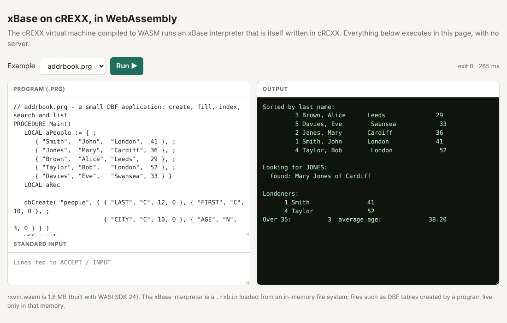
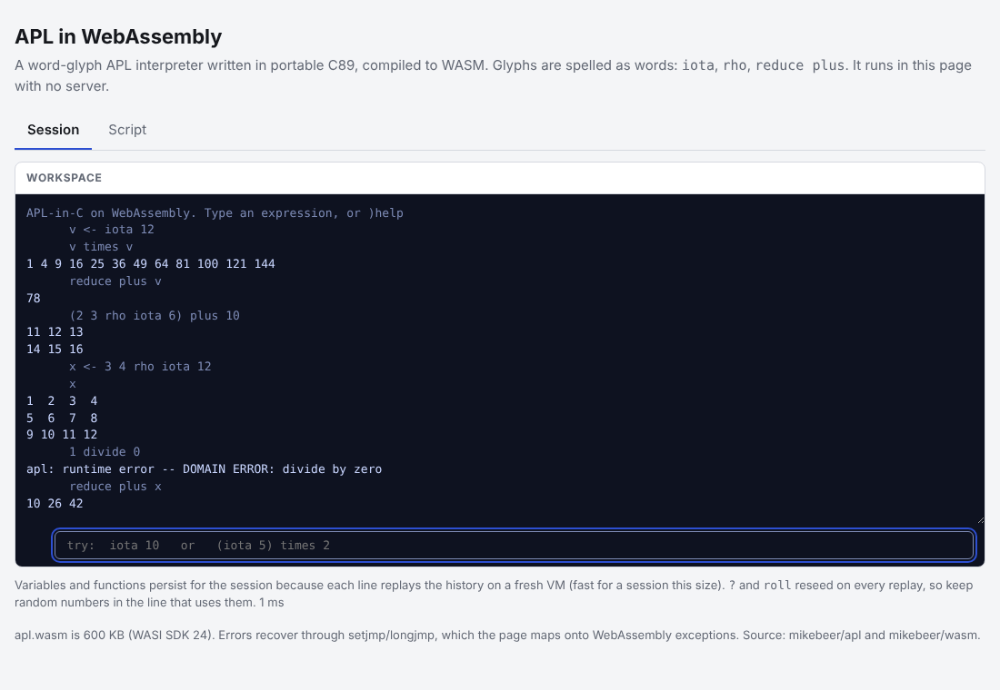

# wasm

Things built with WebAssembly: language interpreters compiled with the WASI SDK, plus browser demos.

| Directory | What | Size |
|---|---|---|
| `crexx/` | the cREXX virtual machine (`rxvm.wasm`); runs any `.rxbin`, including the xBase interpreter | 1.8 MB |
| `apl/` | [mikebeer/apl](https://github.com/mikebeer/apl), the word-glyph APL interpreter (`apl.wasm`) | 0.6 MB |
| `web/` | builds the self-contained demo pages | |
| `dist/` | built `.wasm` files and the demo pages `apl.html`, `xbase.html` | |

Each page loads the `.wasm` from inline base64, so it works from a file or any static host. They use
[`@bjorn3/browser_wasi_shim`](https://github.com/bjorn3/browser_wasi_shim) for stdin, stdout and an in-memory file system.

## Build

Needs WASI SDK 24 (`wasi-sdk-24.0-x86_64-linux`) and Node 22.

    # APL
    WASI_SDK=/opt/wasi-sdk APL_SRC=~/apl sh apl/build.sh
    node apl/run.js dist/apl.wasm ~/apl/examples/hello.apl

    # cREXX VM (see crexx/README.md for the three environment variables)
    WASI_SDK=... CREXX_SRC=... GEN=... bash crexx/build.sh
    node crexx/run.js dist/rxvm.wasm DIR xbase -a program.prg

    # demo pages (once: cd web && npm i @bjorn3/browser_wasi_shim esbuild)
    python3 web/build_pages.py

## Findings

- **APL (C89):** compiles unchanged. `setjmp`/`longjmp` need three tiny JS imports (`apl/sjlj.js`) and a
  host with WebAssembly exception handling. `tmpfile()` is stubbed.
- **cREXX VM:** the default instruction loop is one function of about 400,000 lines that the WebAssembly
  backend cannot compile; `-DCREXX_VM_HANDLER_PANEL=1` fixes that. About 2.6x slower than native on a
  plain loop. Sockets, fork, signals and threads are stubbed to fail cleanly; `dlopen` plugins do not load.
- Not done: `rxc`/`rxas` in WASM, Regina REXX.

