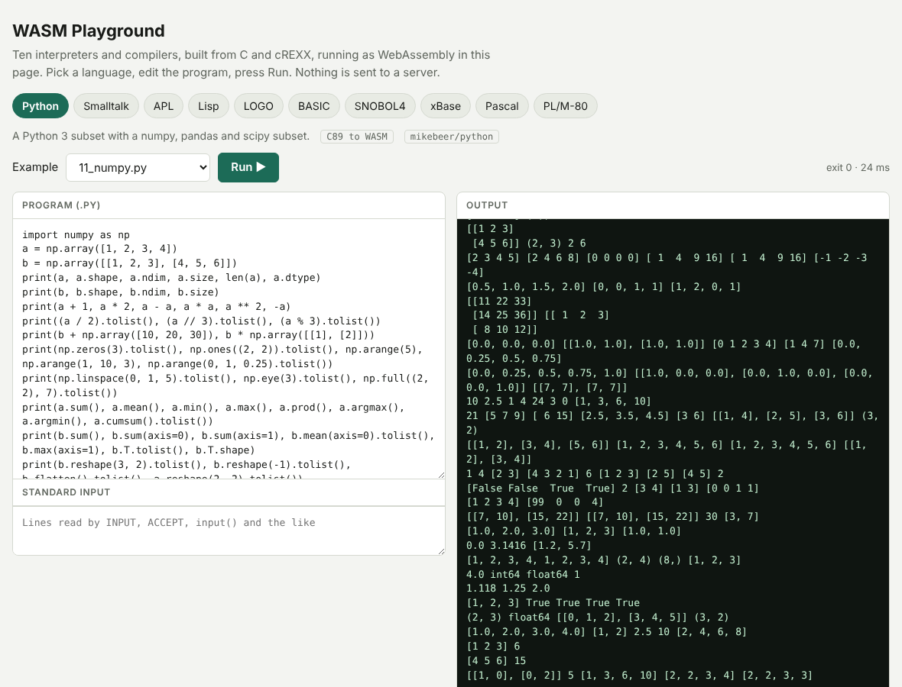

# wasm

mikebeer's interpreters and compilers running as WebAssembly, with a browser playground.

**Playground:** `dist/playground.html` (serve `dist/` from any static host, for example `python3 -m http.server` in `dist/`).
One page, ten languages, each run in a Web Worker on an in-memory file system. Nothing is sent to a server.

| Language | Repo | How it runs | Size |
|---|---|---|---|
| Python (with numpy, pandas, scipy subsets) | [python](https://github.com/mikebeer/python) | C89 build, `py.wasm` | 1.1 MB |
| Smalltalk | [smalltalk](https://github.com/mikebeer/smalltalk) | C89 build, `st.wasm` | 0.55 MB |
| APL | [apl](https://github.com/mikebeer/apl) | C89 build, `apl.wasm` | 0.6 MB |
| Lisp | [lisp](https://github.com/mikebeer/lisp) | cREXX program on `rxvm.wasm` | |
| LOGO (draws an SVG) | [logo](https://github.com/mikebeer/logo) | cREXX program on `rxvm.wasm` | |
| BASIC | [basic](https://github.com/mikebeer/basic) | cREXX program on `rxvm.wasm` | |
| SNOBOL4 | [snobol](https://github.com/mikebeer/snobol) | cREXX program on `rxvm.wasm` | |
| xBase | [xbase](https://github.com/mikebeer/xbase) | cREXX program on `rxvm.wasm` | |
| Pascal | [pascal](https://github.com/mikebeer/pascal) | compiler on `rxvm.wasm`, then `rxas.wasm`, then the program | |
| PL/M-80 | [PLM](https://github.com/mikebeer/PLM) | same three steps | |

The cREXX VM is `rxvm.wasm` (1.9 MB) and the cREXX assembler is `rxas.wasm` (0.9 MB). Every cREXX program is a
`.rxbin` (under `dist/assets/rxbin/`, stored as `.bin`) that the VM loads from the in-memory file system.

Not included: `pipe` (needs Regina REXX) and the empty `java` and `prolog` repos. Python and Smalltalk also have cREXX
implementations; the faster C ones are used here.

## Layout

    c89/      build script, JS setjmp support and stubs for the C interpreters (apl, python, smalltalk)
    crexx/    build scripts for rxvm.wasm and rxas.wasm, WASI shims, Node runner
    web/      page builders (build_playground.py, build_pages.py), tests, screenshots script
    dist/     built output: playground.html, languages.json, assets/ (wasm, rxbin, library bundles),
              and two single-file demos (apl.html with a REPL, xbase.html)

## Rebuild

Needs WASI SDK 24 (`wasi-sdk-24.0-x86_64-linux`), Node 22, and checkouts of the language repos next to each other.

    # C interpreters
    WASI_SDK=... sh c89/build.sh apl ../apl/apl_all.c
    WASI_SDK=... sh c89/build.sh py  ../python/c/py_all.c
    WASI_SDK=... sh c89/build.sh st  ../smalltalk/c/st_all.c
    # cREXX VM and assembler (see crexx/README.md)
    WASI_SDK=... CREXX_SRC=... GEN=... bash crexx/build.sh
    WASI_SDK=... CREXX_SRC=... CREXX_BUILD=... bash crexx/build_rxas.sh
    # compile each cREXX interpreter once with a native cREXX (rxc -n, then rxas) to get its .rxbin
    # page and manifest
    (cd web && npm i @bjorn3/browser_wasi_shim esbuild)
    REPOS=~/src python3 web/build_playground.py

## Findings

- **C89 interpreters:** compile unchanged. `setjmp`/`longjmp` need three tiny JS imports (`c89/sjlj.js`) and a host with
  WebAssembly exception handling.
- **cREXX VM:** the default instruction loop is one function of about 400,000 lines that the WebAssembly backend cannot
  compile; `-DCREXX_VM_HANDLER_PANEL=1` fixes that. About 2.6x slower than native on a plain loop. Sockets, fork,
  signals and threads are stubbed to fail cleanly. `dlopen` plugins do not load, so the float plugin (BASIC and
  SNOBOL4 need it) is linked in statically.
- **cREXX assembler:** builds with the same shims and needs no stubs beyond a stderr hook.
- Not done: `rxc` (the cREXX compiler) in WASM, so new cREXX programs are compiled on the host; Regina REXX.

